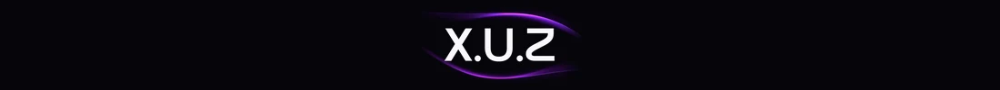

<picture>
  <source media="(prefers-reduced-motion: reduce) and (max-width: 640px)" srcset="https://raw.githubusercontent.com/senhorxuz/senhorxuz/main/art/abissal-vertical-imovel.svg">
  <source media="(prefers-reduced-motion: reduce)" srcset="https://raw.githubusercontent.com/senhorxuz/senhorxuz/main/art/abissal-panorama-imovel.svg">
  <source media="(max-width: 640px)" srcset="https://raw.githubusercontent.com/senhorxuz/senhorxuz/main/art/abissal-vertical.svg">
  
</picture>

<details>
<summary>Ver a água-viva só em caracteres</summary>

```text
              . - ~ ~ - .
          . : . '  |  ' . : .
        .:  .'   . | .   '.  :.
       /   /   .'  |  '.   \   \
      :   :   :    |    :   :   :
      '._.'-._.'-._.'-._.'-._.'
        )   :   )  :    (  :
       (   (   (    )   :   )
        )   )   :  (   (   (
      .'  .'   (    )   )   '.
     '   (    .'   (   :
          '  '      '.  '.
```

</details>

<picture>
  <source media="(prefers-reduced-motion: reduce) and (max-width: 640px)" srcset="https://raw.githubusercontent.com/senhorxuz/senhorxuz/main/art/assinatura-vertical.png">
  <source media="(prefers-reduced-motion: reduce)" srcset="https://raw.githubusercontent.com/senhorxuz/senhorxuz/main/art/assinatura-panorama.png">
  <source media="(max-width: 640px)" srcset="https://raw.githubusercontent.com/senhorxuz/senhorxuz/main/art/assinatura-vertical.webp">
  
</picture>

