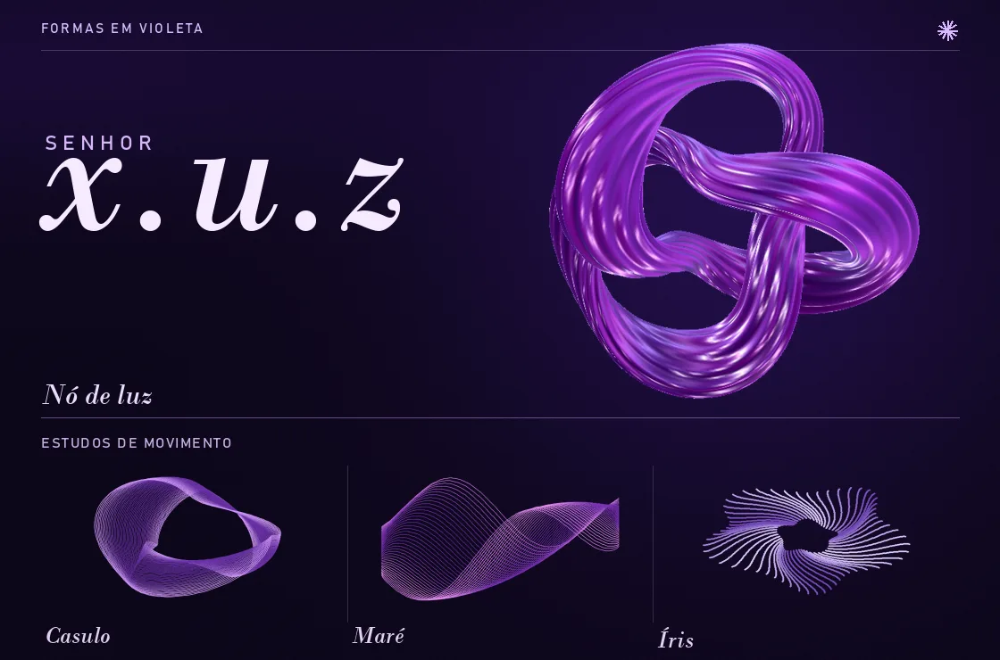

<picture>
  <source media="(prefers-reduced-motion: reduce) and (max-width: 640px)" srcset="https://raw.githubusercontent.com/senhorxuz/senhorxuz/main/art/vertical.png">
  <source media="(prefers-reduced-motion: reduce)" srcset="https://raw.githubusercontent.com/senhorxuz/senhorxuz/main/art/panorama.png">
  <source media="(max-width: 640px)" srcset="https://raw.githubusercontent.com/senhorxuz/senhorxuz/main/art/vertical.webp">
  
</picture>

