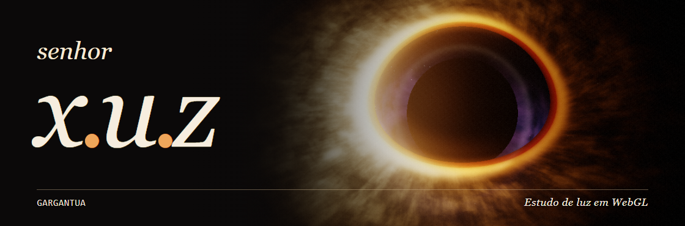

<picture>
  <source media="(max-width: 600px)" srcset="https://raw.githubusercontent.com/senhorxuz/senhorxuz/main/assets/capa-compacta.png">
  
</picture>

Faço ferramentas para trabalhar com IA e experimentos gráficos para o navegador. Dois projetos mostram bem esses lados do meu trabalho.

### [Gargantua](https://github.com/senhorxuz/gargantua) · Computação gráfica

O anel de luz da capa saiu deste projeto. Um shader calcula o caminho da luz ao redor de um buraco negro de Schwarzschild em tempo real. Dá para orbitar a cena, inclinar o disco e acompanhar como a imagem muda. [Ver o shader em GLSL ↗](https://github.com/senhorxuz/gargantua/blob/main/gargantua/js/shaders.js)

### [Axon Works](https://github.com/senhorxuz/AxonWorks) · Ferramentas para IA

Quando eu troco do Claude para o Codex no meio de um projeto, quero continuar da última decisão. A Axon guarda decisões, evidências e próximos passos em SQLite no computador. Um servidor MCP entrega esse histórico à próxima sessão. [Conhecer a interface ↗](https://github.com/senhorxuz/AxonWorks#-as-telas)

### Outros projetos

- **[TrendsCenter](https://github.com/senhorxuz/TrendsCenter)** — Painel de pesquisa de tendências em Reels que registra a fonte, a data e o mercado de cada sinal.
- **[TikTok Downloader](https://github.com/senhorxuz/Tiktok-Downloader)** — Aplicativo local para organizar downloads de vídeo, individuais ou em lote, com Next.js e FFmpeg.

